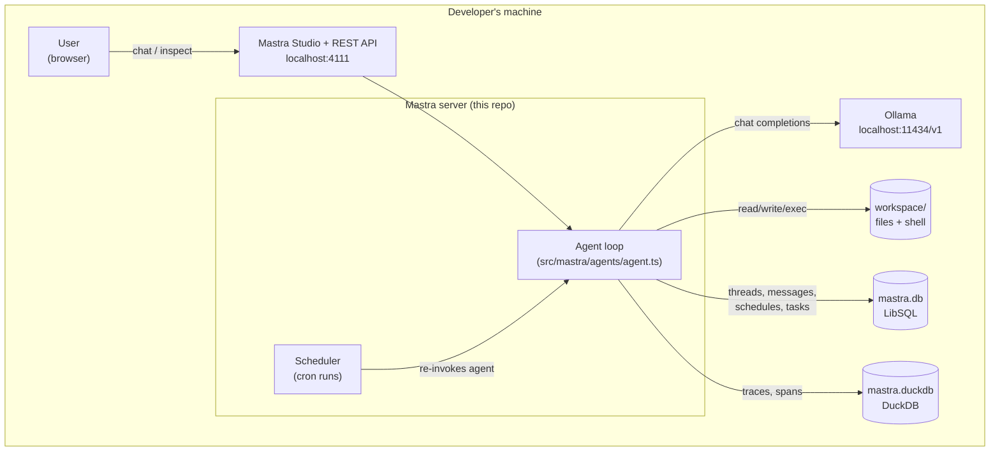
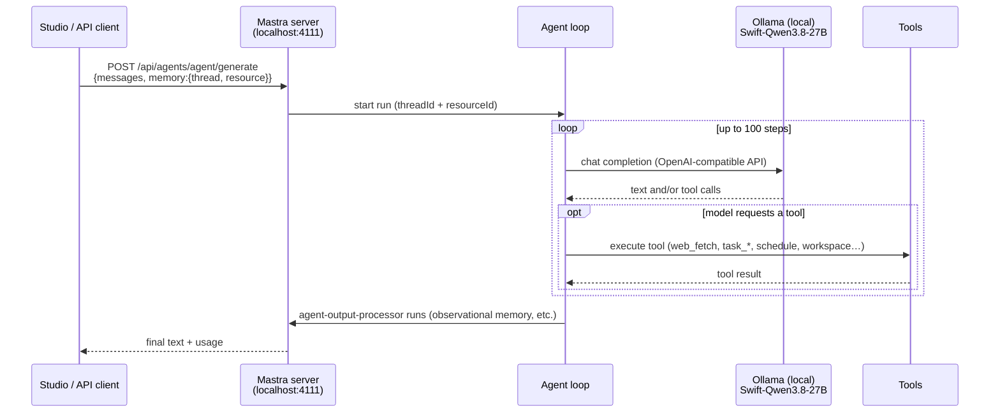
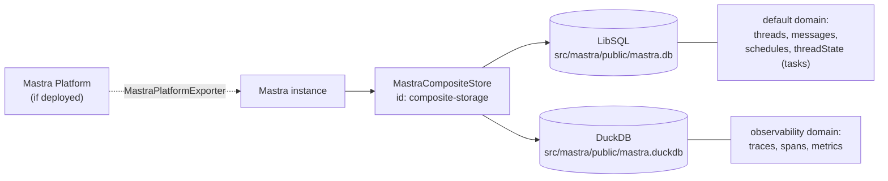

# System Design — mastra-agent

A single-agent Mastra application that runs fully on a developer's machine. One general-purpose agent (`agent`) chats with users through Mastra Studio (port 4111), thinks with a local Ollama model over the OpenAI-compatible API, acts through a sandboxed file/command workspace plus web-fetch and cron-schedule tools, remembers conversations in LibSQL, and records every run as traces in DuckDB.

The design has three load-bearing decisions:

1. **Local-first model** — the agent is wired to Ollama via an OpenAI-compatible config (`api: 'chat'`), because neither the scaffold CLI nor the built-in `openai` router (Responses API) can target a local Chat-Completions endpoint. See [Model Configuration](#model-configuration-local-ollama).
2. **Composite storage** — one `MastraCompositeStore` routes conversation data to LibSQL and telemetry to DuckDB, keeping the chat path independent of observability volume. See [Storage & Observability](#storage--observability).
3. **Sandboxed agency** — all filesystem and shell access is confined to a workspace directory with read-before-write and delete-approval gates, so a local (and therefore cheaper to re-run) model can act without unbounded side effects. See [Agent Architecture](#agent-architecture--request-flow).

Read on for the system context, repo layout, request lifecycle, storage/observability pipeline, and model wiring.

## System Context

`mastra-agent` is a self-contained, local-first AI agent application built on [Mastra](https://mastra.ai) (a TypeScript framework for agents). Everything runs on the developer's machine: the LLM is a local Ollama model, storage is local files, and there are no mandatory cloud dependencies.



| System | What it is | Why it exists |
| --- | --- | --- |
| **Mastra Studio / API** (`:4111`) | Web UI + REST surface for the agent | Where a human chats with the agent and inspects threads, traces, schedules |
| **Ollama** (`:11434/v1`) | Local LLM server exposing an OpenAI-compatible endpoint | Provides the model with no cloud calls or API keys |
| **`workspace/`** | Sandboxed directory for file + shell tools | Gives the agent a safe, scoped place to create/edit files and run commands |
| **LibSQL (`mastra.db`)** | Local SQLite-compatible database | Persists conversation threads, messages, schedules, and task state across restarts |
| **DuckDB (`mastra.duckdb`)** | Local columnar database | Stores observability traces/spans separately from chat data |

Entry points: `http://localhost:4111` (Studio UI) and `http://localhost:4111/api` (REST). Ollama is a peer service the agent calls out to; it is not part of this repo.

## Repository Layout

```text
mastra-agent/
├── src/mastra/
│   ├── index.ts              # Mastra instance: registers agent, storage, observability
│   ├── agents/agent.ts       # The agent: model (Ollama), instructions, tools, memory, workspace
│   └── tools/schedule-tools.ts  # start_schedule / stop_schedule cron tools
├── .env                      # OLLAMA_BASE_URL, OLLAMA_MODEL (gitignored)
├── .env.example              # Template for .env
├── package.json              # Scripts: dev / build / start (wraps the mastra CLI)
├── tsconfig.json             # ES2022 modules — required by Mastra; CommonJS will fail
├── AGENTS.md                 # Conventions for coding assistants (load the mastra skill first)
├── .agents/skills/           # Bundled Mastra skills for coding assistants
└── src/mastra/public/        # Runtime artifacts created by `npm run dev` (not source):
    ├── mastra.db (+ -shm/-wal)   # LibSQL storage
    ├── mastra.duckdb             # DuckDB observability store
    └── workspace/                # Agent's sandboxed file/command directory
```

Notes:

- **Scripts** — always use `npm run dev` / `npm run build` / `npm run start`; they wrap `mastra dev|build|start` with the project's bundler config. Don't invoke the `mastra` CLI subcommands directly for these.
- **`src/mastra/public/`** is generated at runtime (databases, workspace). It is not part of the source tree and should not be hand-edited; deleting it resets local state.
- **TypeScript** — the project is ESM (`"type": "module"`) targeting ES2022, a hard Mastra requirement.

## Agent Architecture & Request Flow

The repo contains a single agent (`agent`, defined in `src/mastra/agents/agent.ts`) registered on the Mastra instance in `src/mastra/index.ts`. It is an "Agent Harness": a general-purpose assistant with local file access, web fetching, task tracking, and recurring schedules.

### Request lifecycle

A chat request (from Studio at `http://localhost:4111` or the REST API) enters the Mastra server, which runs the agent loop: send messages to the model, execute any tool calls the model requests, feed results back, repeat — up to `maxSteps: 100`.



Key loop settings (`agent.ts`):

- `maxSteps: 100` — hard cap on model/tool round trips per run.
- `autoResumeSuspendedTools: true` — tools that suspend a run (e.g. pending approvals) resume automatically when their condition is met.
- Memory requires a `threadId` and `resourceId` on every request; runs without them fail in the output-processor stage.

### Tools

| Tool | Source | Purpose |
| --- | --- | --- |
| `ask_user` | built-in (`@mastra/core/tools`) | Ask the user a clarifying question mid-run |
| `web_fetch` | built-in | Fetch and read a URL |
| `start_schedule` / `stop_schedule` | `src/mastra/tools/schedule-tools.ts` | Create/pause cron-scheduled recurring agent runs, bound to the current thread |
| `task_write`, `task_update`, `task_complete`, `task_check` | `TaskSignalProvider` (signal) | Durable, thread-scoped task list; state survives memory truncation |
| Workspace tools (`write_file`, `edit_file`, `delete`, …) | `Workspace` (below) | File operations inside the agent's sandboxed workspace |

### Workspace subsystem

The agent gets a local filesystem sandbox rooted at `workspace/` (created under `src/mastra/public/workspace/` by the dev server):

- `LocalFilesystem` — file read/write/edit/delete, with `requireReadBeforeWrite: true` on write/edit (the model must read a file before modifying it).
- `LocalSandbox` — command execution scoped to the same directory.
- Delete operations are gated behind `requireApproval: true`, so they suspend the run until approved.

### Schedules

`start_schedule` registers a cron job in Mastra's scheduler that re-invokes this agent with a fixed prompt on the same thread/resource, giving "tell me X every minute" behavior. `stop_schedule` pauses it by schedule id.

## Storage & Observability

Storage is configured on the Mastra instance (`src/mastra/index.ts`) as a `MastraCompositeStore`: one storage object that routes each data domain to its own backend.



- **Default domain → LibSQL** (`@mastra/libsql`): conversation threads, messages, schedules, and thread-scoped state (including the task list from `TaskSignalProvider`) persist to a local SQLite-compatible file. The config is `file:./mastra.db`, which the dev server materializes under `src/mastra/public/mastra.db`. Setting `TURSO_DATABASE_URL` + `TURSO_AUTH_TOKEN` in `.env` switches the same configuration to a Turso cloud database — no code change.
- **Observability domain → DuckDB** (`@mastra/duckdb`): traces and spans are stored separately from conversation data (in `src/mastra/public/mastra.duckdb`), keeping the hot path (chat) independent of telemetry volume.

### Observability pipeline

The `Observability` config in `index.ts` registers:

- `serviceName: 'mastra'` — identifies this app in trace data.
- `MastraStorageExporter` — writes traces/spans into the DuckDB observability domain (queryable via Studio or `mastra api trace query`).
- `MastraPlatformExporter` — forwards telemetry to Mastra Platform when the project is deployed there; inert for local-only runs.
- `SensitiveDataFilter` span processor — scrubs sensitive values from spans before export.

Every agent run produces a trace (visible in Studio's traces view); tool calls and model invocations appear as nested spans, which is how you debug a specific step of the agent loop.

## Model Configuration (Local Ollama)

The agent runs entirely against a local [Ollama](https://ollama.com) server — no cloud LLM calls. The model is wired in `src/mastra/agents/agent.ts` as an **OpenAI-compatible config object**, not a router model string:

```ts
const OLLAMA_BASE_URL = process.env.OLLAMA_BASE_URL ?? 'http://localhost:11434/v1';
const OLLAMA_MODEL    = process.env.OLLAMA_MODEL    ?? 'Swift-Qwen3.8-27B-Q4_K_S:latest';

const model: MastraModelConfig = {
  id: `ollama/${OLLAMA_MODEL}` as `${string}/${string}`,
  url: OLLAMA_BASE_URL,
  apiKey: 'ollama',   // placeholder — Ollama ignores it
  api: 'chat',        // Chat Completions, not the OpenAI Responses API
};
```

The same `model` object is reused for the agent's main loop **and** its observational memory, so title generation and memory extraction also run locally.

### Why an OpenAI-compatible config (and not the obvious alternatives)

| Approach | Why it doesn't work here |
| --- | --- |
| `npm create mastra -- --llm ollama` | The scaffold CLI only accepts `mastra`, `openai`, `anthropic`, `google`, `xai`. Ollama isn't a model-router provider, so the flag is rejected. |
| Built-in `openai` router + `OPENAI_BASE_URL` env var | The `openai` provider speaks the **Responses API**, which Ollama does not implement. Pointing it at Ollama fails at request time. |
| OpenAI-compatible config (`api: 'chat'`) ✅ | Routes to `/v1/chat/completions`, which is exactly what Ollama exposes. This is the path used. |

### Requirements & behavior

- **Ollama must be running** on `localhost:11434` (or whatever `OLLAMA_BASE_URL` points at) before the dev server can serve a chat.
- **The model must be pulled first**: `ollama pull Swift-Qwen3.8-27B-Q4_K_S`. A missing model surfaces as a 404 from Ollama, not a Mastra error.
- **Tool calling requires a tool-capable model.** The agent registers many tools; if the selected model can't emit structured function calls, tool steps will fail. `Swift-Qwen3.8-27B` supports it.
- **Web search is unavailable locally.** The built-in `webSearchTool` only supports OpenAI/Anthropic/Google/xAI providers and hard-fails on Ollama, so it was removed. `web_fetch` (fetch a known URL) remains as the web capability.

### Swapping models or providers

Change `OLLAMA_MODEL` / `OLLAMA_BASE_URL` in `.env` to use a different local model or server — no code change. To move off Ollama entirely, replace the `model` object with a router string (e.g. `'openai/gpt-…'`) and restore any provider-specific tools you'd dropped.
